# API de Delivery de Pizza - FastAPI

API de delivery de pizza utilizando o framework FastAPI.

---

## Demonstração

| Página Inicial | Criação de Conta |
| :---: | :---: |
| 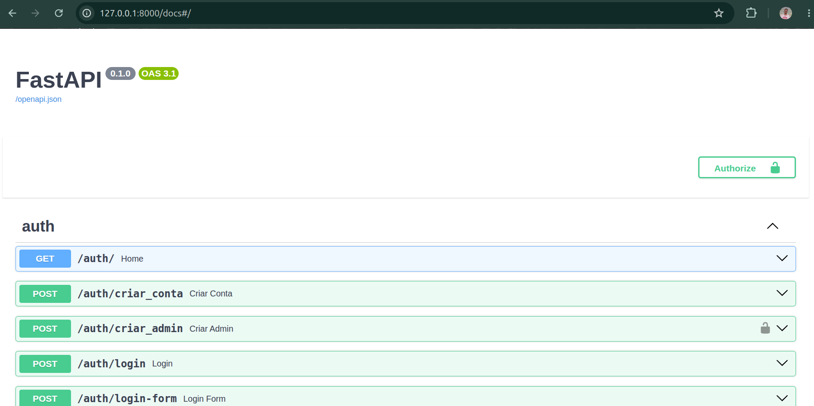 | 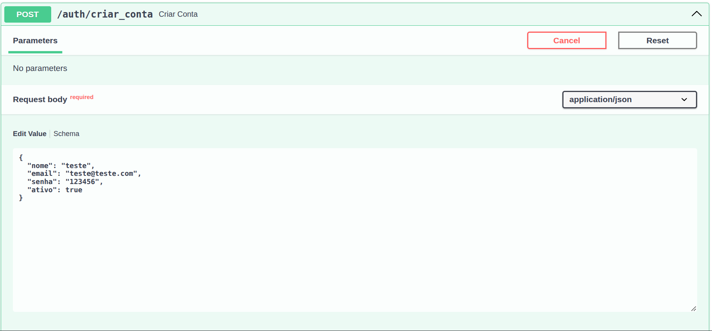 |

| Conta Criada | Criação de Admin |
| :---: | :---: |
| 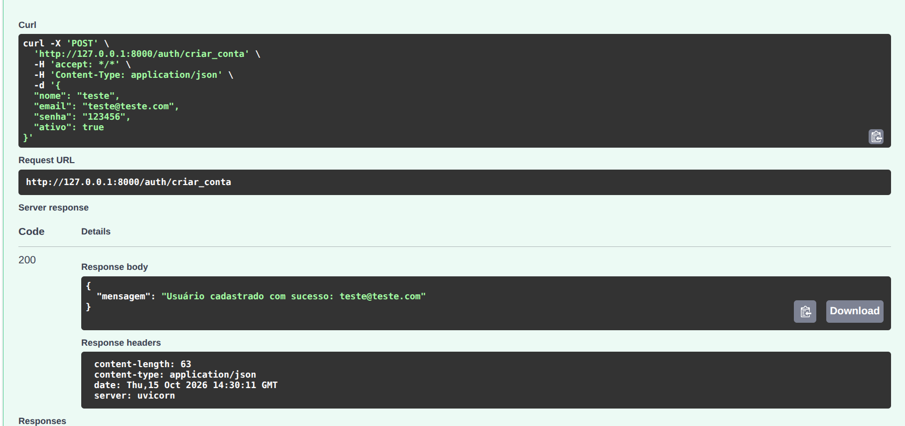 | 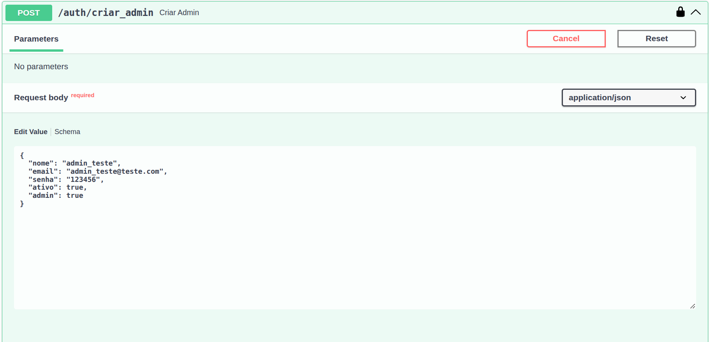 |

| Admin Criado | Login |
| :---: | :---: |
| 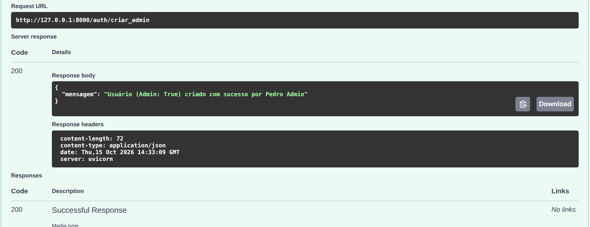 | 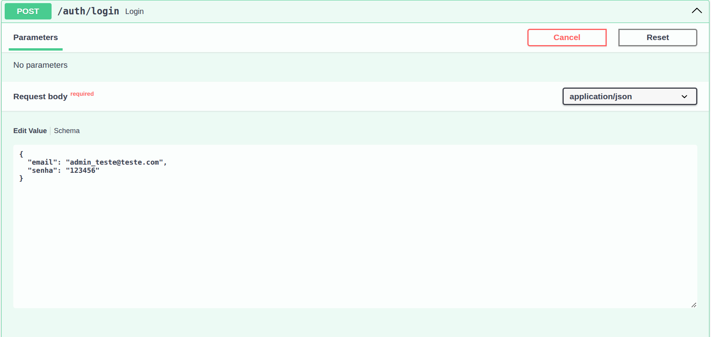 |

| Login Realizado | Criação de Pedido |
| :---: | :---: |
| 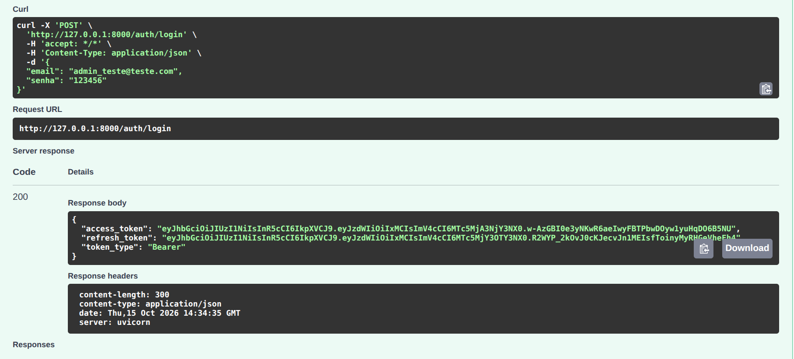 | 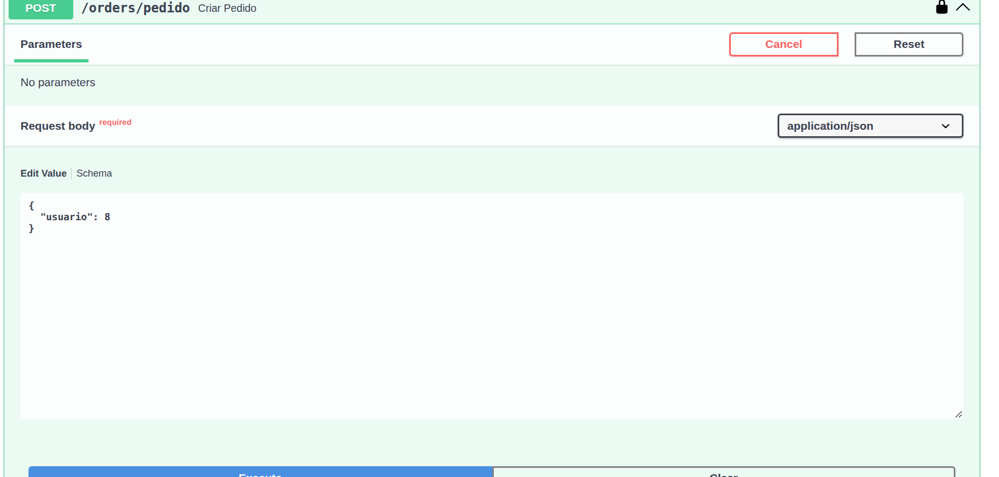 |

| Pedido Criado | Adição de Item ao Pedido|
| :---: | :---: |
| 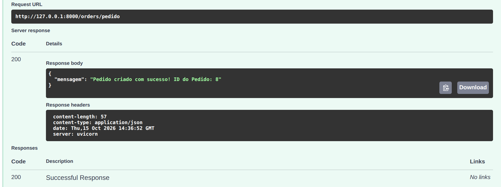 | 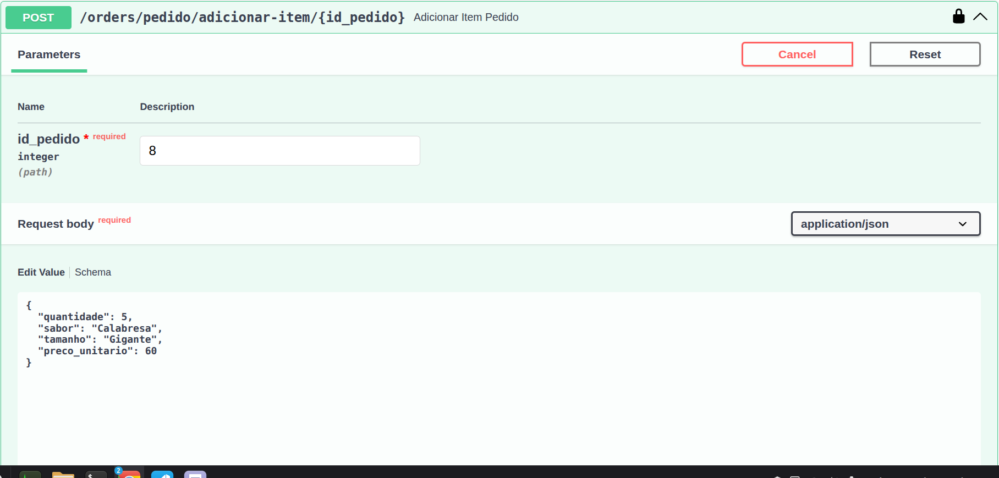 |

| Cancelamento de Pedido |
| :---: |
| 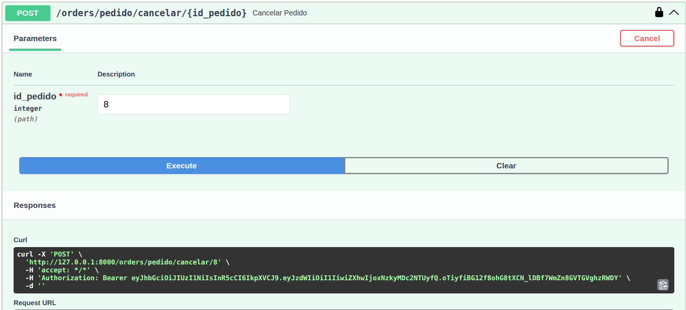 |

---

## Tecnologias

Este projeto foi desenvolvido utilizando as seguintes tecnologias:

- **Python 3.12.3**
- **FastAPI (Criação de API)**
- **Uvicorn (Servidor ASGI para rodar a aplicação)**
- **SQLAlchemy (Criação e modificação de banco de dados)**
- **Jose (Autenticação de usuários)**
- **Pwdlib (Criptografia de senhas)**
- **Python-Dotenv (Utilização de variáveis de ambiente)**

---

## Funcionalidades

- [x] Criação e autenticação de usuários
- [x] Criação e autenticação de administradores
- [x] Criação e edição de pedidos
- [x] Visualização de pedidos de um usuário
- [x] Cancelamento de pedidos

---

## Estrutura de Dados

O projeto conta com um arquivo `banco.db` contendo exemplos de usuários e pedidos para permitir o teste da API, bem como a criação e armazenamento de informações de novos usuários e pedidos. As senhas são armazenadas após criptografia, tornando o banco de dados seguro. Todos os usuários foram criados usando e-mails fictícios e todos os pedidos são fictícios.

---

## Como Executar o Projeto

### Pré-requisitos

Antes de começar, você precisará ter instalado em sua máquina:
- [Git](https://git-scm.com)
- [Python 3.12](https://www.python.org/)

### Passo a Passo

1. **Clone este repositório:**
   ```bash
   git clone https://github.com/Brazil25/delivery_fastapi/
   ```

2. **Acesse a pasta do projeto:**
   ```bash
   cd delivery_fastapi
   ```

3. **Crie e ative o ambiente virtual (opcional, mas recomendado):**
   ```bash
   python -m venv .venv
   source venv/bin/activate  # Linux/Mac
   # ou: venv\Scripts\activate  # Windows
   ```

4. **Instale as dependências:**
   ```bash
   pip install -r requirements.txt
   ```

5. **Crie sua chave secreta e salve em uma variável de ambiente:**
   - Crie um arquivo .env com a sua chave secreta nos moldes do arquivo .env.example.

6. **Execute a aplicação:**
   ```bash
   uvicorn main:app --reload
   ```

7. **Acesse o link:**
   - Acesse o link de desenvolvimento gerado pelo uvicorn e digite "(seu_link)/docs" na barra de endereços para ter acesso à página do FastAPI e todas as suas funcionalidades.

---

## Licença

Este projeto está sob a licença MIT.
